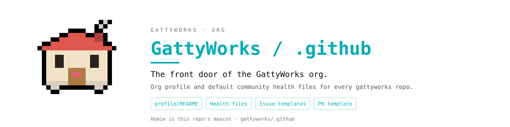

# design/ - GattyWorks / .github visual assets

Generated assets for this repo's README banner and mascot (**Homie**).
Everything here comes from the shared GattyWorks mascot/banner generator in
the workspace; regenerate there rather than hand-editing the SVGs.

## Banner

Project-themed: the colors and facts come from this repo, with the mascot as
one element. `banner.html` is a self-contained reference page showing the
banner plus the exact theme tokens it was built from.

## Mascot - Homie

| Static | Blinking |
| --- | --- |
|  |  |

`mascot.svg` is the static sprite; `mascot-animated.svg` blinks (CSS inside
the SVG, honors prefers-reduced-motion). Both are transparent-background,
22x20 pixel-grid sprites with a black outline halo, so they sit cleanly on
any surface.
