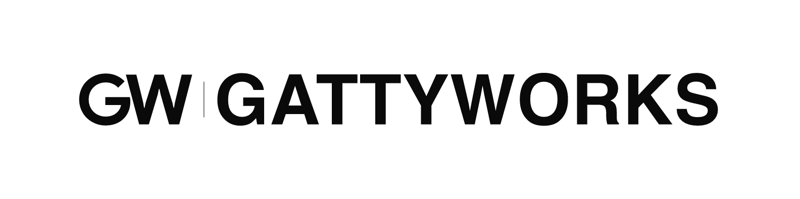

  <picture>
    <source media="(prefers-color-scheme: dark)" srcset="https://raw.githubusercontent.com/gattyworks/.github/main/profile/assets/gw-linkedin-dark.png">
    <source media="(prefers-color-scheme: light)" srcset="https://raw.githubusercontent.com/gattyworks/.github/main/profile/assets/gw-linkedin-light.png">
    
  </picture>

<h1 align="center">Software, AI, and the work behind them.</h1>

GattyWorks builds digital products and reviews the systems businesses depend on.

  <a href="https://gattyworks.com"><b>Website</b></a> &nbsp; · &nbsp;
  <a href="https://gattyworks.com/showcase"><b>Selected work</b></a> &nbsp; · &nbsp;
  <a href="mailto:hello@gattyworks.com"><b>Start a conversation</b></a>

We are a design and engineering studio based in Mangaluru and Bengaluru, India. We work with founders and teams on software reviews, product development, and AI workflows. We also build our own tools and share reusable work.

## What we do

| Area | How we help |
| --- | --- |
| Software and AI reviews | Review architecture, security, data flows, vendor dependencies, and technology spend. Record findings and practical next steps. |
| Websites and product design | Build responsive websites, product interfaces, and design systems with attention to content, accessibility, and performance. |
| Applications and integrations | Build web applications, internal tools, APIs, and workflows that connect existing systems. |
| AI engineering | Develop agents and automation with evaluation, monitoring, and clear limits. Research smaller models that can run locally. |

We agree on the scope, required access, and deliverables before work starts. Our work can include the review, implementation, documentation, and handover.

## Selected work

A mix of client websites, studio products, and research. A public website does not mean its source code or full application is public.

| Project | What to explore |
| --- | --- |
| [Ninan's Steakhouse](https://ninanssteakhouse.com) | Restaurant website with menu browsing, locations, and reservations. |
| [Gazette Intel](https://gazetteintel.com) | Official Gazette search and source-linked public records. Private-beta product. |
| [Fear of Wife](https://fearofwife.com) | Editorial and community website with essays and practical tools. |
| [Edible Factor](https://ediblefactor.com) | Food-intelligence product website and interactive walkthrough. Private beta. |
| [Deep Research](https://research.gattyworks.com) | Research workspace introduction, from a starting clue to an evidence-backed report. |
| [Metrics](https://metrics.gattyworks.com) | First-party website analytics. Dashboard access is separate. |
| [GattyBird](https://birds.gattyworks.com) | Offline bird-identification research. A private Windows CLI preview, not a field-ready model. |
| [DPDPA engineering audit](https://dpdpa.gattyworks.com) | Engineering-audit workflow and its open-source skill. |
| [abhiigatty.com](https://abhiigatty.com) | Founder website, technical writing, and small browser tools. |

### Studio concepts

These are fictional brands and working design demos, not operating businesses. Explore the layouts and sample interactions.

| Concept | Focus |
| --- | --- |
| [Avara](https://avara.gattyworks.com) | Coorg villa retreat and stay planning |
| [Saaya](https://saaya.gattyworks.com) | Coastal villas and sample stay enquiries |
| [KORAAI](https://koraai.gattyworks.com) | Home textiles, product choices, and a sample shopping bag |
| [DAURVA](https://daurva.gattyworks.com) | Running apparel and a sample shopping flow |
| [TAALYARD](https://taalyard.gattyworks.com) | Dance classes and timetable browsing |
| [ZORMA](https://zorma.gattyworks.com) | Strength training programmes and session selection |
| [GattyBite](https://bite.gattyworks.com) | Meal browsing, plans, and a sample cart |
| [GattyPower](https://power.gattyworks.com) | Energy dashboard with sample readings and exports |

[Browse the showcase and build notes](https://gattyworks.com/showcase).

## Open source

These repositories are public and use the MIT license. Check each repository for setup instructions and current status.

| Repository | What it provides |
| --- | --- |
| [India DPDPA Skill](https://github.com/gattyworks/india-dpdpa-skill) | An evidence-based engineering-audit skill for reviewing applications and data flows. |
| [Brand Illustrations](https://github.com/gattyworks/brand-illustrations) | A framework for consistent illustration prompts and recurring brand characters. |
| [Windowseat](https://github.com/gattyworks/windowseat) | An Android train-journey companion with maps and a low-distraction view. |

[Email MCP Hub](https://github.com/gattyworks/email-mcp-hub) remains available as an **archived, unmaintained** email-integration project.

## Build with us

Tell us what you want to build, review, or improve. Include a link and the decision you need to make.

**[hello@gattyworks.com](mailto:hello@gattyworks.com)** · [Website](https://gattyworks.com) · [Technical writing](https://gattyworks.com/blog)

[LinkedIn](https://www.linkedin.com/company/gattyworks-private-limited) · [Instagram](https://instagram.com/gattyworks) · [X](https://x.com/gattyworks)
